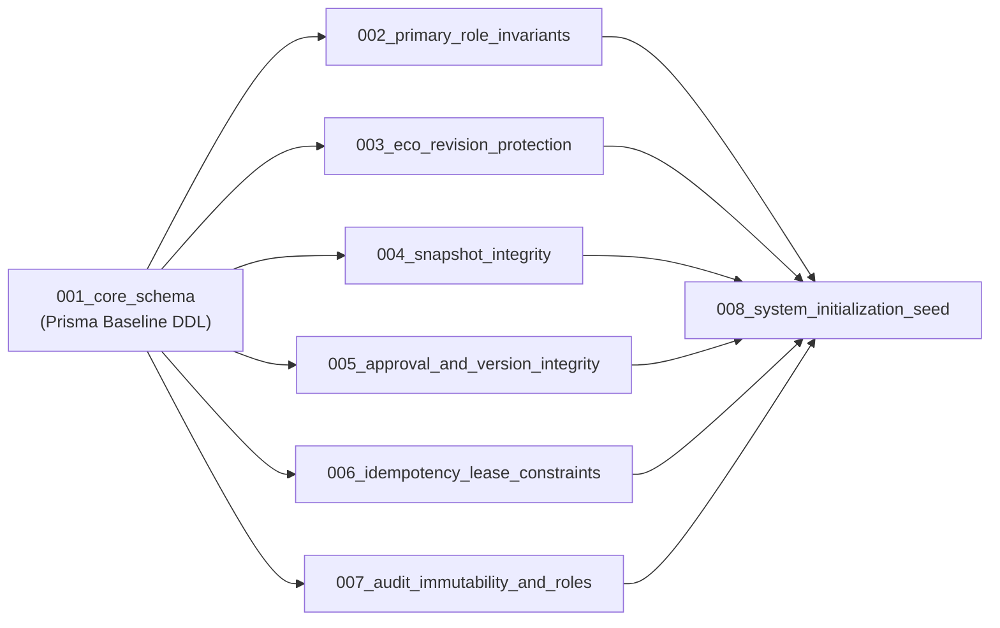

# ECOFlow — Final Database Architecture Consolidation & Readiness Report

**Document Version:** 1.0.0 (FINAL CONSOLIDATION)
**Status:** Architecture Consolidated & Implementation-Ready Specification
**Target Engine:** PostgreSQL 15+ / Supabase Managed PostgreSQL
**Active Workspace:** `T:\My Projects\ECO-Flow`
**Reference Repository (STRICT READ-ONLY):** `T:\My Projects\EcoFlow-source`

---

## 1. Executive Summary & Readiness Decision

This document represents the **final consolidation** of the complete database architecture for ECOFlow. It harmonizes all design artifacts created across Milestones 3.1 through 3.2.1.8 into a unified, technically rigorous, implementation-ready database specification.

Every architectural invariant—including PostgreSQL function signatures, trigger creation versus execution privileges, Row-Level Security (RLS) policies, global lock hierarchies, audit table immutability, deterministic snapshot transformations, idempotency lease state machines, and migration sequencing—has been cross-audited, statically verified, and reconciled.

### Final Readiness Assessment:
$$\mathbf{READY\ FOR\ CONTROLLED\ DATABASE\ IMPLEMENTATION}$$

No structural, relational, or cryptographic blockers remain in the design. All domain unit tests and Prisma AST validations pass cleanly. Live PostgreSQL integration tests are formally documented as pending runtime execution against an isolated database harness in Milestone 3.2.

---

## 2. Canonical Global Lock Hierarchy & Application Protocols

Deadlocks and lock inversions are prevented by strictly enforcing a single, system-wide, deterministic locking sequence:

$$\mathbf{IdempotencyKeys} \longrightarrow \mathbf{Users} \longrightarrow \mathbf{UserRoles} \longrightarrow \mathbf{Products} \longrightarrow \mathbf{BOMs} \longrightarrow \mathbf{ECOs} \longrightarrow \mathbf{ECORevisions} \longrightarrow \mathbf{ECOChanges / Snapshots}$$

### 2.1 Role Mutation Protocol (`Users` $\to$ `UserRoles`)
- **Engine Invariant**: A `BEFORE ROW` trigger on `user_roles` cannot establish lock ordering by itself because PostgreSQL acquires tuple locks on `user_roles` *before* the trigger fires on `UPDATE` or `DELETE`.
- **Application Protocol**:
  1. Determine all affected user IDs (`NEW.user_id` on INSERT; `OLD.user_id` on DELETE; both `OLD` and `NEW` on reassignment).
  2. Acquire row locks on `users` in ascending UUID order prior to executing `user_roles` DML:
     ```sql
     SELECT id FROM public.users WHERE id IN ($user_a, $user_b) ORDER BY id ASC FOR UPDATE;
     ```
  3. Execute DML on `public.user_roles`.
  4. Deferred constraint trigger `trg_user_roles_validate_primary_deferred` validates that every affected active user possesses exactly 1 primary role at commit.
- **Deadlock Guarantee**: Two concurrent cross-reassignments ($U_1 \to U_2$ and $U_2 \to U_1$) always acquire $U_1$ then $U_2$, eliminating circular wait conditions.

### 2.2 Revision Mutation Protocol (`Products` $\to$ `BOMs` $\to$ `ECOs` $\to$ `ECORevisions`)
All revision mutations (editing draft changes, submitting, review progression, decisioning) adhere to the application transaction sequence:
1. **Resolve Parent IDs**: `SELECT product_id, bom_id FROM public.ecos WHERE id = $eco_id;`.
2. **Lock Product**: `SELECT id FROM public.products WHERE id = $product_id FOR UPDATE;`.
3. **Lock BOM**: `SELECT id FROM public.boms WHERE id = $bom_id AND product_id = $product_id FOR UPDATE;`.
4. **Lock ECO Header**: `SELECT id, active_revision_no, status FROM public.ecos WHERE id = $eco_id FOR UPDATE;` (revalidates product/BOM immutability).
5. **Lock Exact ECORevision**: `SELECT revision_number, status FROM public.eco_revisions WHERE eco_id = $eco_id AND revision_number = $rev_no FOR UPDATE;`.
6. **Revalidate & Mutate**: Revalidate status and pointer, insert snapshot (if submitting), and update revision status.
7. **Header Synchronization**: The `AFTER INSERT OR UPDATE OF status` trigger synchronizes `ecos.status` without establishing new locks because the parent ECO was already locked top-down in Step 4.

---

## 3. Active Revision & ECO Header Consistency

The relational integrity between `ecos.active_revision_no` and `eco_revisions(eco_id, revision_number)` is enforced by database constraints and triggers:

```mermaid
flowchart TD
    subgraph DDL Level
        FK["fk_ecos_active_revision<br/>FOREIGN KEY (id, active_revision_no)<br/>REFERENCES eco_revisions (eco_id, revision_number)<br/>DEFERRABLE INITIALLY DEFERRED"]
    end

    subgraph Revision Mutation
        R1[eco_revisions.status updated] --> TRG1[trg_eco_revisions_sync_header_status<br/>AFTER INSERT OR UPDATE OF status]
        TRG1 --> F1[fn_sync_eco_header_from_active_revision]
        F1 --> COND{Is revision active?<br/>active_revision_no == revision_number}
        COND -- Yes --> U1["UPDATE ecos SET status = NEW.status<br/>WHERE status IS DISTINCT FROM NEW.status"]
        COND -- No (Historical) --> SKIP[RETURN NULL; No-op]
    end

    subgraph Pointer Advancement
        P1[ecos.active_revision_no updated] --> TRG2[trg_ecos_sync_on_pointer_change<br/>BEFORE UPDATE OF active_revision_no]
        TRG2 --> F2[fn_sync_eco_status_on_pointer_change]
        F2 --> S1[NEW.status := target_rev_status]
    end

    subgraph Commit-Time Guard
        C1[Transaction Commit] --> TRG3[trg_ecos_guard_header_revision_consistency<br/>DEFERRABLE INITIALLY DEFERRED]
        TRG3 --> F3[fn_guard_eco_header_consistency]
        F3 --> V1{ecos.status === active_revision.status?}
        V1 -- Yes --> OK[Transaction Committed]
        V1 -- No --> FAIL[RAISE EXCEPTION 23514]
    end
```



### Guarantees:
- **Historical Revision Independence**: When historical revisions transition (e.g. cancelled), `fn_sync_eco_header_from_active_revision()` reads `ecos.active_revision_no`, detects `v_active_rev_no != NEW.revision_number`, and exits immediately without writes.
- **Loop Termination**: Predicate `status IS DISTINCT FROM NEW.status` prevents recursive updates.
- **Initial Atomicity**: Setting `active_revision_no = 1` while inserting the ECO header and Revision 1 succeeds atomically within the transaction via `DEFERRABLE INITIALLY DEFERRED` constraint validation.

---

## 4. Ownership, Roles, Privileges & RLS Matrix

### 4.1 Role Responsibilities:
- **`ecoflow_admin`**: Migration administrator role. Owns schemas (`public`, `app_private`) and all relational tables. Holds DDL privileges.
- **`ecoflow_schema_owner`**: Non-login, non-superuser, non-BYPASSRLS trusted function owner (`NOLOGIN`). Owns all 14 functions. Holds targeted table grants on `users` and `ecos`.
- **`ecoflow_api_user`**: Runtime backend API connection identity. Holds **zero table ownership** and **zero direct `EXECUTE` privileges on trigger routines**. Holds least-privilege DML grants on domain tables and strictly append-only `SELECT, INSERT` on audit tables.
- **`service_role`**: Supabase elevated infrastructure role with `BYPASSRLS`. **Disentangled conceptually and not used for application traffic**.
- **`authenticated` / `anon`**: Supabase client-facing roles. Zero direct table or function privileges.

### 4.2 Comprehensive 14-Function Inventory:

| # | Function Signature | Mode | Owner Role | Search Path | Trigger Table | Cross-Table Access | Runtime Direct EXECUTE? |
|---|---|---|---|---|---|---|---|
| **1** | `public.fn_lock_users_for_role_mutation()` | **`SECURITY DEFINER`** | `ecoflow_schema_owner` | `pg_catalog, app_private, pg_temp` | `public.user_roles` | `public.users` (`SELECT FOR UPDATE`) | **REVOKED** |
| **2** | `public.fn_validate_primary_role_deferred()` | **`SECURITY INVOKER`** | `ecoflow_schema_owner` | `pg_catalog, app_private, public, pg_temp` | `public.user_roles` | `public.users`, `public.user_roles` | **REVOKED** |
| **3** | `public.fn_validate_user_activation_deferred()` | **`SECURITY INVOKER`** | `ecoflow_schema_owner` | `pg_catalog, app_private, public, pg_temp` | `public.users` | `public.user_roles` | **REVOKED** |
| **4** | `public.fn_enforce_eco_revision_lifecycle()` | **`SECURITY INVOKER`** | `ecoflow_schema_owner` | `pg_catalog, app_private, public, pg_temp` | `public.eco_revisions` | None (reads `OLD`/`NEW`) | **REVOKED** |
| **5** | `public.fn_sync_eco_header_from_active_revision()` | **`SECURITY DEFINER`** | `ecoflow_schema_owner` | `pg_catalog, app_private, pg_temp` | `public.eco_revisions` | `public.ecos` (`UPDATE status`) | **REVOKED** |
| **6** | `public.fn_guard_eco_header_consistency()` | **`SECURITY INVOKER`** | `ecoflow_schema_owner` | `pg_catalog, app_private, public, pg_temp` | `public.ecos` | `public.eco_revisions` | **REVOKED** |
| **7** | `public.fn_sync_eco_status_on_pointer_change()` | **`SECURITY INVOKER`** | `ecoflow_schema_owner` | `pg_catalog, app_private, public, pg_temp` | `public.ecos` | `public.eco_revisions` | **REVOKED** |
| **8** | `public.fn_protect_eco_product_bom_immutability()` | **`SECURITY INVOKER`** | `ecoflow_schema_owner` | `pg_catalog, app_private, public, pg_temp` | `public.ecos` | None (reads `OLD`/`NEW`) | **REVOKED** |
| **9** | `public.fn_protect_eco_changes()` | **`SECURITY INVOKER`** | `ecoflow_schema_owner` | `pg_catalog, app_private, public, pg_temp` | `public.eco_changes` | `public.ecos`, `public.eco_revisions` | **REVOKED** |
| **10** | `public.fn_check_submitted_revision_snapshot()` | **`SECURITY INVOKER`** | `ecoflow_schema_owner` | `pg_catalog, app_private, public, pg_temp` | `public.eco_revisions` | `public.eco_revision_snapshots` | **REVOKED** |
| **11** | `public.fn_protect_idempotency_identity()` | **`SECURITY INVOKER`** | `ecoflow_schema_owner` | `pg_catalog, app_private, public, pg_temp` | `public.idempotency_keys` | None (reads `OLD`/`NEW`) | **REVOKED** |
| **12** | `public.fn_reject_update_or_delete()` | **`SECURITY INVOKER`** | `ecoflow_schema_owner` | `pg_catalog, app_private, public, pg_temp` | Snapshots, Versions, Approvals, Audits | None | **REVOKED** |
| **13** | `public.fn_reject_truncate()` | **`SECURITY INVOKER`** | `ecoflow_schema_owner` | `pg_catalog, app_private, public, pg_temp` | Versions, Audits | None | **REVOKED** |
| **14** | `public.fn_protect_version_releases()` | **`SECURITY INVOKER`** | `ecoflow_schema_owner` | `pg_catalog, app_private, public, pg_temp` | `public.version_releases` | None (reads `OLD`/`NEW`) | **REVOKED** |

### 4.3 Trigger Execution Privilege Semantics
- In PostgreSQL 15+, `CREATE TRIGGER` requires table ownership (held by `ecoflow_admin`) and `EXECUTE` on the function at migration creation time.
- Trigger firing is event-driven by table DML; the runtime backend role (`ecoflow_api_user`) does **not** need or possess runtime `EXECUTE` privilege on trigger routines.

### 4.4 Dedicated SECURITY DEFINER RLS Policies
Because `ecoflow_schema_owner` lacks `BYPASSRLS` and does not own application tables, target tables evaluate RLS:
- `public.users`: Policy `pol_users_select_for_schema_owner` (`FOR SELECT TO ecoflow_schema_owner USING (true)`) and policy `pol_users_lock_for_schema_owner` (`FOR UPDATE TO ecoflow_schema_owner USING (true) WITH CHECK (true)`).
- `public.ecos`: Policy `pol_ecos_sync_for_schema_owner` (`FOR UPDATE TO ecoflow_schema_owner USING (true) WITH CHECK (true)`).

---

## 5. Audit Log Immutability & Engineering Data Integrity

`public.audit_logs` and `public.login_audits` are protected across four independent layers:
1. **Ownership Separation**: Tables owned by `ecoflow_admin`; runtime backend (`ecoflow_api_user`) has zero ownership.
2. **Table Grant Level**: `REVOKE UPDATE, DELETE, TRUNCATE ON public.audit_logs, public.login_audits FROM ecoflow_api_user, PUBLIC;`.
3. **Database Triggers**: Row triggers execute `fn_reject_update_or_delete()` (`23514`); statement triggers execute `fn_reject_truncate()` (`42501`).
4. **Force Row-Level Security**: `ALTER TABLE ... FORCE ROW LEVEL SECURITY;` ensures RLS is enforced against all roles including table owners.
5. **No Sequence Privileges**: UUID primary keys are generated via `gen_random_uuid()` from `pg_catalog`. No sequences are used.
6. **Regulatory Clarification**: Database-level immutability represents an internal engineering traceability decision; formal regulatory certification (ISO 9001, FDA 21 CFR Part 11) requires operational and procedural controls outside the database engine.

---

## 6. Idempotency State Machine & Approval Governance

### 6.1 Idempotency State Transitions
The idempotency lifecycle strictly enforces:
$$\mathbf{PROCESSING} \longrightarrow \mathbf{COMPLETED}$$
- Request identity fields (`scope`, `key`, `actor_id`, `resource_id`, `request_hash`, `created_at`) are immutable via `fn_protect_idempotency_identity()`.
- Phase A insertion uses `ON CONFLICT (scope, key) DO NOTHING`. Expired leases are atomically reclaimed comparing both `lease_expires < clock_timestamp()` and `claim_token = $existing_token`.
- Phase B acquires exclusive row lock on `idempotency_keys` before executing business logic, revalidating lease expiration against PostgreSQL server time.
- Completed reservations clear claim token and lease expiration, and store an immutable `response_body`.
- All approval mutations (version creation, release, audit insertion, and idempotency completion) execute in a **single unified transaction**.

### 6.2 Approval Governance Rules
- Lead approver ID must exactly match authenticated caller.
- Caller must be an `ACTIVE` user with authoritative database permission `eco:approve`.
- Administrative overrides require authoritative permission `admin:all` and mandatory justification ($\ge 10$ characters).
- Formal decisions are unique per revision (`@@unique([eco_id, revision_number])`).

---

## 7. Deterministic Snapshot & Version Integrity

- **Frozen Snapshot Derivation**: `ProductVersion` and `BOMVersion` are derived strictly from the immutable `eco_revision_snapshots` row, never mutable live records.
- **Deterministic Identity**: Added components are assigned deterministic UUID v5 values calculated using SHA-1 over namespace `4a5e9f82-3d71-5b2c-9a10-2f8e4c6b8d0a` and name `${ecoId}:${revisionNumber}:${changeId}:${partNumber}`.
- **Exact Decimal Arithmetic**: Monetary calculations (`unit_cost`, `total_cost`) and quantities use `Decimal.js` fixed-point decimal arithmetic (zero IEEE 754 floating-point drift).
- **Atomic Version Counters**: In-place atomic increments (`current_version = current_version + 1`) on locked `products` and `boms` allocate monotonic, gapless version numbers.

---

## 8. Proposed Migration Sequence

The implementation sequence in Milestone 3.2 is structured into 8 dependency-ordered migration files:



---

## 9. Verification & Status of Test Suites

### 9.1 Executed & 100% Passing Unit & Schema Suites (38/38 Tests Passing)
- **Prisma Schema AST Validation**:
  ```powershell
  pnpm --filter @ecoflow/api exec prisma validate
  # The schema at prisma\schema.prisma is valid 🚀
  ```
- **Uncached Vitest Test Suites**:
  ```powershell
  pnpm --filter @ecoflow/domain-types run test -- --no-cache
  # ✓ tests/enums.test.ts (7 tests) - 100% passing

  pnpm --filter @ecoflow/validations run test -- --no-cache
  # ✓ tests/snapshot-transformer.test.ts (15 tests) - 100% passing
  # ✓ tests/schemas.test.ts (16 tests) - 100% passing
  ```

### 9.2 Pending Runtime-Only Database Integration Tests (Category 3, 4, 7 & 8)
The following tests are formally documented as **DESIGN SPECIFICATIONS (NOT VERIFIED AGAINST LIVE DB)** and require execution against a dedicated PostgreSQL 15+ / Supabase test instance in Milestone 3.2:
- Category 3: Database trigger invariant enforcement (`SEC-1.1` – `SEC-4.3`).
- Category 4: Multi-connection concurrency and lease reclamation races (`SEC-5.1` – `SEC-5.2`).
- Category 7: RLS policy evaluation under non-superuser owner context (`SEC-7.1` – `SEC-7.2`).
- Category 8: Advanced lock-order concurrency and cross-revision serialization (`SEC-8.1` – `SEC-8.5`).

---

## 10. Implementation Blockers & Prerequisites for Milestone 3.2

To transition from this consolidated design to controlled database implementation, the following external prerequisites must be provided:
1. **Live Database Credentials**: Connection strings (`DATABASE_URL` for transaction pooling, `DIRECT_URL` for direct DDL migrations) for an isolated PostgreSQL 15+ / Supabase development instance.
2. **User Authorization**: Explicit user approval to generate and apply physical migration scripts via Prisma Migrate CLI.

---

## 11. Strict Boundary Confirmations

- **Reference Repository**: `T:\My Projects\EcoFlow-source` remained strictly **READ-ONLY** and untouched.
- **No Database Connections**: No PostgreSQL or Supabase instances contacted, provisioned, or modified.
- **No Migrations Executed**: No `prisma migrate dev/deploy` or `prisma db push` commands run.
- **No Production Code Changes**: Zero changes to production application runtime code.
- **Git State**: Clean working tree preserved without commits, pushes, resets, stashes, or discards.
- **Zero Premature Test Claims**: Pending database tests are explicitly reported as unexecuted design specifications.

---

### Final Readiness Decision:
$$\mathbf{READY\ FOR\ CONTROLLED\ DATABASE\ IMPLEMENTATION}$$
*(Awaiting user authorization and database credentials to begin Milestone 3.2 implementation).*
