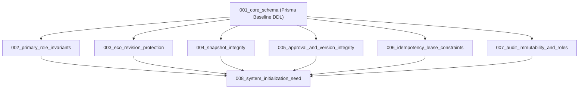

# Proposed Migration Sequence Specification

This document defines the structured, dependency-ordered sequence of PostgreSQL migration scripts planned for implementation in Milestone 3.2.

> **Status:** Unexecuted Migration Architecture Plan. No migration files have been created or executed.

---

## 1. Migration Dependency Graph



---

## 2. Detailed Migration Groups

### Migration 001: Core Schema Baseline (`001_core_schema.sql`)
- **Dependencies:** None.
- **Contents:**
  - Creates 14 enums (`UserStatus`, `ProductCategoryStatus`, `ProductStatus`, `BOMStatus`, `BOMComponentType`, `ECOStatus`, `PriorityLevel`, `ChangeType`, `ChangeTarget`, `ImpactType`, `ApprovalDecision`, `IdempotencyStatus`, `VersionReleaseStatus`, `AuditSeverity`, `NotificationType`).
  - Creates 26 baseline relational tables, composite primary keys, unique constraints, and foreign key relationships as defined in `schema.prisma`.
  - Configures `onDelete: Restrict` on historical entities.
- **Rollback Consideration:** `DROP TABLE ... CASCADE; DROP TYPE ...;`.
- **Validation Requirements:** Verifies table presence, columns, types, and baseline foreign keys.

---

### Migration 002: Primary-Role Invariants (`002_primary_role_invariants.sql`)
- **Dependencies:** `001_core_schema.sql`.
- **Contents:**
  - Creates partial unique index: `idx_user_roles_one_primary_per_user` on `user_roles (user_id) WHERE is_primary = true`.
  - Creates function `fn_lock_users_for_role_mutation()` and trigger `trg_user_roles_lock_users_before_mutation`.
  - Creates function `fn_validate_primary_role_deferred()` and deferred constraint trigger `trg_user_roles_validate_primary_deferred`.
  - Creates function `fn_validate_user_activation_deferred()` and deferred constraint trigger `trg_users_validate_activation_deferred`.
- **Rollback Consideration:** Drops constraint triggers, functions, and index.
- **Validation Requirements:** Validates that active users cannot be created without a primary role and that multiple primary roles are blocked.

---

### Migration 003: ECO Revision & Change Protection (`003_eco_revision_protection.sql`)
- **Dependencies:** `001_core_schema.sql`.
- **Contents:**
  - Creates composite foreign key `fk_ecos_active_revision`:
    ```sql
    ALTER TABLE ecos ADD CONSTRAINT fk_ecos_active_revision
    FOREIGN KEY (id, active_revision_no)
    REFERENCES eco_revisions (eco_id, revision_number)
    ON UPDATE RESTRICT ON DELETE RESTRICT DEFERRABLE INITIALLY DEFERRED;
    ```
  - Creates function `fn_enforce_eco_revision_lifecycle()` and trigger `trg_eco_revisions_enforce_lifecycle` on `eco_revisions`.
  - Creates function `fn_sync_eco_header_revision_status()` and trigger `trg_ecos_sync_header_revision_status` on `ecos`.
  - Creates function `fn_protect_eco_product_bom_immutability()` and trigger `trg_eco_product_bom_immutable` on `ecos`.
  - Creates function `fn_protect_eco_changes()` and trigger `trg_eco_changes_enforce_draft_revision` on `eco_changes`.
- **Rollback Consideration:** Drops triggers, functions, and foreign key constraint.
- **Validation Requirements:** Asserts that updating changes on submitted revisions is rejected and active revision pointers cannot be cross-wired.

---

### Migration 004: Snapshot Integrity & Existence (`004_snapshot_integrity.sql`)
- **Dependencies:** `001_core_schema.sql`, `003_eco_revision_protection.sql`.
- **Contents:**
  - Creates generic immutable function `fn_reject_update_or_delete()`.
  - Creates trigger `trg_eco_revision_snapshots_immutable` on `eco_revision_snapshots`.
  - Creates function `fn_check_submitted_revision_snapshot()` and deferred constraint trigger `trg_eco_revisions_require_snapshot_deferred` on `eco_revisions`.
- **Rollback Consideration:** Drops snapshot triggers and functions.
- **Validation Requirements:** Asserts that submitting a revision without a snapshot fails at commit.

---

### Migration 005: Version, Approval & Release Integrity (`005_approval_and_version_integrity.sql`)
- **Dependencies:** `001_core_schema.sql`, `004_snapshot_integrity.sql`.
- **Contents:**
  - Creates trigger `trg_approvals_immutable` on `approvals`.
  - Creates trigger `trg_product_versions_immutable` on `product_versions`.
  - Creates trigger `trg_bom_versions_immutable` on `bom_versions`.
  - Creates function `fn_protect_version_releases()` and trigger `trg_version_releases_controlled_mutation` on `version_releases`.
- **Rollback Consideration:** Drops immutability triggers on approvals, versions, and releases.
- **Validation Requirements:** Tests immutable updates on published versions and valid `SCHEDULED -> RELEASED -> DEPRECATED` release transitions.

---

### Migration 006: Idempotency Lease Constraints (`006_idempotency_lease_constraints.sql`)
- **Dependencies:** `001_core_schema.sql`.
- **Contents:**
  - Creates partial index for active leases:
    `CREATE INDEX idx_idempotency_active_leases ON idempotency_keys (scope, lease_expires) WHERE status = 'PROCESSING';`
  - Creates function `fn_protect_idempotency_identity()` and trigger `trg_idempotency_keys_protect_identity` on `idempotency_keys`.
  - Ensures composite candidate index `idx_idempotency_scope_key` is backed by PostgreSQL unique index.
- **Rollback Consideration:** Drops trigger, function, and index `idx_idempotency_active_leases`.
- **Validation Requirements:** Verifies execution performance of atomic reservation query with `ON CONFLICT (scope, key) DO NOTHING` and rejects modification of identity fields.

---

### Migration 007: Audit Immutability & Database Privileges (`007_audit_immutability_and_roles.sql`)
- **Dependencies:** `001_core_schema.sql`.
- **Contents:**
  - Creates triggers `trg_audit_logs_immutable` and `trg_login_audits_immutable` using `fn_reject_update_or_delete()`.
  - Creates function `fn_reject_truncate()` and triggers `trg_audit_logs_no_truncate` and `trg_login_audits_no_truncate`.
  - Configures PostgreSQL role permissions: revokes `UPDATE`, `DELETE`, `TRUNCATE` from all roles on audit tables; grants only `SELECT, INSERT` to backend `service_role`.
- **Rollback Consideration:** Drops triggers; restores default table grants.
- **Validation Requirements:** Verifies that even privileged service role cannot delete or truncate audit logs.

---

### Migration 008: System Initialization Seed (`008_system_initialization_seed.sql`)
- **Dependencies:** Migrations 001 through 007.
- **Contents:**
  - Seeds system roles (`ADMINISTRATOR`, `LEAD_ENGINEER`, `APPROVER`, `OPERATOR`).
  - Seeds standard permissions (`admin:all`, `eco:create`, `eco:edit`, `eco:submit`, `eco:approve`, `eco:cancel`, `product:read`, `product:write`, `bom:read`, `bom:write`).
  - Populates `role_permissions` join table.
  - Seeds initial root administrator user with exactly 1 primary role (`ADMINISTRATOR`), satisfying deferred trigger `trg_user_roles_validate_primary_deferred`.
- **Rollback Consideration:** Deletes seeded system data.
- **Validation Requirements:** Confirms root user and role-permission associations are cleanly queryable and satisfy all primary role invariants.
