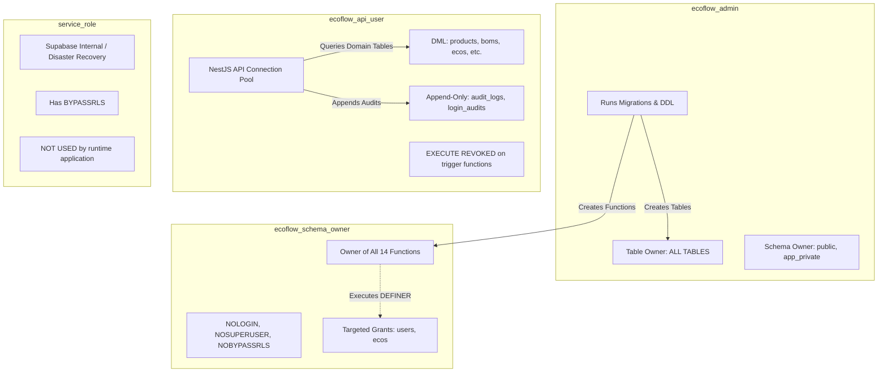

# PostgreSQL Security & Privilege Hardening Audit

**Document Version:** 1.2.0
**Status:** Implementation-Ready Security Specification (Milestone 3.2.1.7 Reconciled)
**Target Engine:** PostgreSQL 15+ / Supabase Managed PostgreSQL

---

## 1. Executive Summary & Least-Privilege Architecture

This audit defines the reconciled, implementation-ready PostgreSQL security specification across schemas, database roles, tables, functions, triggers, Row-Level Security (RLS) policies, and idempotency guarantees for ECOFlow.

### Core Hardening Decisions:
1. **Clear Separation of Role Identities**:
   - **`ecoflow_admin` (Migration & Schema Administrator)**: Administrative owner used during migrations. Owns schemas (`public`, `app_private`) and all relational tables (`users`, `user_roles`, `ecos`, `audit_logs`, `login_audits`, etc.).
   - **`ecoflow_schema_owner` (Trusted Function Owner)**: Non-login, non-superuser, non-BYPASSRLS role (`NOLOGIN NOSUPERUSER NOCREATEDB NOCREATEROLE`). Owns all 14 trigger functions.
   - **`ecoflow_api_user` (Backend Database Login)**: Dedicated connection pool user for NestJS application. **No table ownership**. Holds specific DML permissions and zero direct `EXECUTE` privileges on trigger routines.
   - **`service_role` (Supabase Elevated Admin Role)**: Predefined Supabase role that possesses `BYPASSRLS`. Conceptually separate from `ecoflow_api_user`. **Not used by runtime application connections**; reserved strictly for administrative disaster recovery or background infrastructure tooling.
   - **`authenticated` / `anon` (Client-Facing Roles)**: Zero access to audit tables or trigger routines. Direct database connections from client applications are prohibited; all traffic is routed through the API application layer.
2. **PostgreSQL Trigger Creation vs. Runtime Execution Semantics**:
   - In PostgreSQL 15+, creating a trigger (`CREATE TRIGGER`) requires `TRIGGER` privilege or table ownership on the subject table, plus `EXECUTE` privilege on the trigger function **at creation time**.
   - **Trigger firing does NOT require runtime `EXECUTE` privilege**. When an application user executes table DML (`INSERT`, `UPDATE`, `DELETE`), PostgreSQL automatically fires the trigger. Under `SECURITY INVOKER`, table statements inside the function execute with the caller's privileges; under `SECURITY DEFINER`, they execute with the function owner's privileges.
   - Therefore, direct runtime `EXECUTE` on all 14 trigger routines is **strictly revoked from `PUBLIC`, `anon`, `authenticated`, and `ecoflow_api_user`**, closing arbitrary function calling and error harvesting vectors.
3. **Rigorous SECURITY DEFINER RLS Analysis**:
   - Neither `SECURITY DEFINER` function bypasses RLS because `ecoflow_schema_owner` does not own the target tables (`ecoflow_admin` does) and does not possess `BYPASSRLS`.
   - Explicit, narrowly scoped RLS policies are defined for `ecoflow_schema_owner` on `public.users` and `public.ecos`.
4. **Independent Audit RLS & Immutability Models**:
   - Fully specified for `public.audit_logs` and `public.login_audits`. Tables are owned by `ecoflow_admin`, enabled with `FORCE ROW LEVEL SECURITY`, granted append-only (`SELECT, INSERT`) to `ecoflow_api_user`, and protected by immutability triggers.

---

## 2. Trigger Creation vs. Runtime Execution Privilege Matrix

| # | Trigger Function Signature | Target Table | Trigger Timing & Event | Trigger Creator Role | Creation-Time EXECUTE Required? | Runtime Role Firing Trigger | Runtime Direct EXECUTE Granted? |
|---|---|---|---|---|---|---|---|
| **1** | `public.fn_lock_users_for_role_mutation()` | `public.user_roles` | `BEFORE INSERT OR UPDATE OR DELETE` | `ecoflow_admin` | Yes (Owner has grant) | `ecoflow_api_user` | **NO (REVOKED)** |
| **2** | `public.fn_validate_primary_role_deferred()` | `public.user_roles` | `AFTER INSERT OR UPDATE OR DELETE DEFERRED` | `ecoflow_admin` | Yes | `ecoflow_api_user` | **NO (REVOKED)** |
| **3** | `public.fn_validate_user_activation_deferred()` | `public.users` | `AFTER INSERT OR UPDATE DEFERRED` | `ecoflow_admin` | Yes | `ecoflow_api_user` | **NO (REVOKED)** |
| **4** | `public.fn_enforce_eco_revision_lifecycle()` | `public.eco_revisions` | `BEFORE UPDATE` | `ecoflow_admin` | Yes | `ecoflow_api_user` | **NO (REVOKED)** |
| **5** | `public.fn_sync_eco_header_from_active_revision()` | `public.eco_revisions` | `AFTER INSERT OR UPDATE OF status` | `ecoflow_admin` | Yes | `ecoflow_api_user` | **NO (REVOKED)** |
| **6** | `public.fn_guard_eco_header_consistency()` | `public.ecos` | `AFTER INSERT OR UPDATE DEFERRED` | `ecoflow_admin` | Yes | `ecoflow_api_user` | **NO (REVOKED)** |
| **7** | `public.fn_sync_eco_status_on_pointer_change()` | `public.ecos` | `BEFORE UPDATE OF active_revision_no` | `ecoflow_admin` | Yes | `ecoflow_api_user` | **NO (REVOKED)** |
| **8** | `public.fn_protect_eco_product_bom_immutability()` | `public.ecos` | `BEFORE UPDATE` | `ecoflow_admin` | Yes | `ecoflow_api_user` | **NO (REVOKED)** |
| **9** | `public.fn_protect_eco_changes()` | `public.eco_changes` | `BEFORE INSERT OR UPDATE OR DELETE` | `ecoflow_admin` | Yes | `ecoflow_api_user` | **NO (REVOKED)** |
| **10** | `public.fn_check_submitted_revision_snapshot()` | `public.eco_revisions` | `AFTER INSERT OR UPDATE DEFERRED` | `ecoflow_admin` | Yes | `ecoflow_api_user` | **NO (REVOKED)** |
| **11** | `public.fn_protect_idempotency_identity()` | `public.idempotency_keys` | `BEFORE UPDATE` | `ecoflow_admin` | Yes | `ecoflow_api_user` | **NO (REVOKED)** |
| **12** | `public.fn_reject_update_or_delete()` | Snapshots, Versions, Approvals, Audits | `BEFORE UPDATE OR DELETE` | `ecoflow_admin` | Yes | `ecoflow_api_user` | **NO (REVOKED)** |
| **13** | `public.fn_reject_truncate()` | Versions, Audits | `BEFORE TRUNCATE` | `ecoflow_admin` | Yes | `ecoflow_api_user` | **NO (REVOKED)** |
| **14** | `public.fn_protect_version_releases()` | `public.version_releases` | `BEFORE UPDATE OR DELETE` | `ecoflow_admin` | Yes | `ecoflow_api_user` | **NO (REVOKED)** |

---

## 3. Dedicated SECURITY DEFINER Functions & Target Table RLS Policies

PostgreSQL does **not** grant automatic RLS bypass to `SECURITY DEFINER` routines. Because `ecoflow_schema_owner` does not own `public.users` or `public.ecos` and lacks `BYPASSRLS`, RLS policies on both tables are evaluated when the functions execute.

### 3.1 `fn_lock_users_for_role_mutation()`
- **Purpose**: Acquires `SELECT ... FOR UPDATE` on `public.users` in deterministic UUID order to serialize concurrent role modifications and eliminate cross-reassignment deadlocks.
- **Why Owner Needs Access**: A caller assigning or removing a role must be able to lock the user record to prevent concurrent user deactivation or concurrent role modification.
- **PostgreSQL Privilege & RLS Requirements for `SELECT FOR UPDATE`**:
  - In PostgreSQL 15+, `SELECT ... FOR UPDATE` requires **both** `SELECT` privilege and row-locking (`UPDATE`) privilege on the locked table (`public.users`).
  - When RLS is enabled on `public.users`, PostgreSQL evaluates the `SELECT` policy to determine row visibility. Furthermore, because a row lock is requested, PostgreSQL also evaluates the `UPDATE` policy's `USING` clause (to ensure the user is permitted to lock the row). The `WITH CHECK` clause is not evaluated because no data columns are written during a `SELECT FOR UPDATE`.
- **Target Table RLS Policies**:
  ```sql
  -- 1. SELECT policy granting visibility to ecoflow_schema_owner
  CREATE POLICY pol_users_select_for_schema_owner ON public.users
  FOR SELECT TO ecoflow_schema_owner
  USING (true);

  -- 2. UPDATE policy granting row-locking authorization to ecoflow_schema_owner
  CREATE POLICY pol_users_lock_for_schema_owner ON public.users
  FOR UPDATE TO ecoflow_schema_owner
  USING (true)
  WITH CHECK (true);
  ```
- **Security Justification of Row Visibility**:
  - The policies use `USING (true)` for `ecoflow_schema_owner` because an administrator may assign roles to any user in the system.
  - Because `ecoflow_schema_owner` is a strictly non-login role (`NOLOGIN`) and all direct `EXECUTE` privileges are revoked from `PUBLIC` and client roles, this policy cannot be leveraged by an external caller or client JWT to read or modify user rows.
- **Failsafe Behavior**: If the referenced user does not exist or is invisible under RLS, `IF NOT FOUND` raises an exception with SQLSTATE `23503`, immediately aborting the transaction.

### 3.2 `fn_sync_eco_header_from_active_revision()`
- **Purpose**: Automatically synchronizes `public.ecos.status` when `eco_revisions.status` changes for the active revision.
- **Why Owner Needs Access**: An engineer submitting or progressing an ECO revision possesses write permissions on `eco_revisions`, but may not have direct broad `UPDATE` privileges on the `ecos` header. The function projects status safely.
- **Strict Row Restriction & Top-Down Lock Order**:
  - The application transaction locks the parent ECO top-down (`Products` $\to$ `BOMs` $\to$ `ECOs` $\to$ `ECORevisions`) before mutating the revision.
  - The trigger's `SELECT active_revision_no FROM public.ecos WHERE id = NEW.eco_id;` reads the locked header state.
  - It strictly asserts `v_active_rev_no = NEW.revision_number`. If `NEW.revision_number` is a historical revision, synchronization is skipped (`RETURN NULL;`), guaranteeing historical revisions never mutate the header.
  - The update predicate `WHERE id = NEW.eco_id AND status IS DISTINCT FROM NEW.status` guarantees that the function cannot modify unrelated ECOs and cannot enter recursive update loops.
- **Required Privileges**: `GRANT SELECT, UPDATE (status, updated_at) ON public.ecos TO ecoflow_schema_owner;`
- **Target Table RLS Policy**:
  ```sql
  -- Narrow policy for ecoflow_schema_owner on ecos header synchronization
  CREATE POLICY pol_ecos_sync_for_schema_owner ON public.ecos
  FOR UPDATE TO ecoflow_schema_owner
  USING (true)
  WITH CHECK (true);
  ```

---

## 4. Audit Log RLS, Ownership, Sequences & Unrestricted Visibility

Both audit tables (`public.audit_logs` and `public.login_audits`) operate under independent, multi-layered immutability controls.

### 4.1 Sequence Privileges & ID Generation
- Both `audit_logs` and `login_audits` utilize client-generated / application-generated UUID primary keys (`id UUID PRIMARY KEY DEFAULT gen_random_uuid()`).
- No PostgreSQL sequences (`bigserial` / `CREATE SEQUENCE`) are utilized by either table.
- Function `gen_random_uuid()` is provided by PostgreSQL core `pg_catalog`, requiring no specialized sequence grants or sequence ownership permissions.

### 4.2 Engineering Audit Architecture & Regulatory Scope Clarification
- Under policy `pol_audit_logs_read` and `pol_login_audits_read`, `ecoflow_api_user` has `USING (true)` read visibility.
- **Architectural Scope vs. Regulatory Compliance**:
  - **Internal Engineering Auditability Requirements**: ECOFlow's immutable audit tables are designed to support robust engineering traceability, diagnostic forensics, and internal data governance. Unrestricted backend read visibility allows the API service to generate historical revision histories and audit summaries without data fragmentation.
  - **Regulatory Standards (e.g. ISO 9001, FDA 21 CFR Part 11)**: While append-only storage and cryptographic request hashes align with technical prerequisites of these standards, database-level immutability does not by itself constitute formal regulatory certification or compliance. Full compliance requires procedural controls, electronic signature verification, validated software lifecycles, and operational governance outside the database engine. Multi-tenant partitioning is enforced at the application authorization layer.

### 4.3 Specification for `public.audit_logs`
- **Table Owner**: `ecoflow_admin` (Migration Administrator).
- **RLS Enabled**: `ALTER TABLE public.audit_logs ENABLE ROW LEVEL SECURITY;`
- **FORCE RLS Status**: `ALTER TABLE public.audit_logs FORCE ROW LEVEL SECURITY;`
  - Ensures RLS policies are enforced even against table owners and maintenance scripts.
- **SELECT Policy**:
  ```sql
  CREATE POLICY pol_audit_logs_read ON public.audit_logs
  FOR SELECT TO ecoflow_api_user
  USING (true);
  ```
- **INSERT Policy**:
  ```sql
  CREATE POLICY pol_audit_logs_insert ON public.audit_logs
  FOR INSERT TO ecoflow_api_user
  WITH CHECK (true);
  ```
- **UPDATE / DELETE / TRUNCATE Protection**:
  - No policies defined for `UPDATE` or `DELETE` (default deny under RLS).
  - Explicit table grants revoked: `REVOKE UPDATE, DELETE, TRUNCATE ON public.audit_logs FROM ecoflow_api_user, PUBLIC;`.
  - Row trigger `trg_audit_logs_immutable` executes `fn_reject_update_or_delete()` (`23514`).
  - Statement trigger `trg_audit_logs_no_truncate` executes `fn_reject_truncate()` (`42501`).

### 4.4 Specification for `public.login_audits`
- **Table Owner**: `ecoflow_admin`.
- **RLS Enabled**: `ALTER TABLE public.login_audits ENABLE ROW LEVEL SECURITY;`
- **FORCE RLS Status**: `ALTER TABLE public.login_audits FORCE ROW LEVEL SECURITY;`
- **SELECT Policy**:
  ```sql
  CREATE POLICY pol_login_audits_read ON public.login_audits
  FOR SELECT TO ecoflow_api_user
  USING (true);
  ```
- **INSERT Policy**:
  ```sql
  CREATE POLICY pol_login_audits_insert ON public.login_audits
  FOR INSERT TO ecoflow_api_user
  WITH CHECK (true);
  ```
- **Protection**: Identical multi-layered defense via table grant revocations and immutable triggers.
- **RLS Enabled**: `ALTER TABLE public.login_audits ENABLE ROW LEVEL SECURITY;`
- **FORCE RLS Status**: `ALTER TABLE public.login_audits FORCE ROW LEVEL SECURITY;`
- **SELECT Policy**:
  ```sql
  CREATE POLICY pol_login_audits_read ON public.login_audits
  FOR SELECT TO ecoflow_api_user
  USING (true);
  ```
- **INSERT Policy**:
  ```sql
  CREATE POLICY pol_login_audits_insert ON public.login_audits
  FOR INSERT TO ecoflow_api_user
  WITH CHECK (true);
  ```
- **Protection**: Identical multi-layered defense via table grant revocations and immutable triggers.

---

## 5. Role Mutation Locking Logic & Invariant Validation

The PL/pgSQL function `public.fn_lock_users_for_role_mutation()` handles all mutation branches:

```sql
CREATE OR REPLACE FUNCTION public.fn_lock_users_for_role_mutation()
RETURNS TRIGGER AS $$
BEGIN
  IF (TG_OP = 'INSERT') THEN
    PERFORM 1 FROM public.users WHERE id = NEW.user_id FOR UPDATE;
    IF NOT FOUND THEN
      RAISE EXCEPTION 'Foreign key violation: Referenced user % does not exist or is invisible under RLS',
        NEW.user_id
        USING ERRCODE = '23503';
    END IF;
  ELSIF (TG_OP = 'DELETE') THEN
    PERFORM 1 FROM public.users WHERE id = OLD.user_id FOR UPDATE;
    IF NOT FOUND THEN
      RAISE EXCEPTION 'Referential integrity violation: Cannot delete role for missing or invisible user %',
        OLD.user_id
        USING ERRCODE = '23503';
    END IF;
  ELSIF (TG_OP = 'UPDATE') THEN
    IF (OLD.user_id = NEW.user_id) THEN
      PERFORM 1 FROM public.users WHERE id = NEW.user_id FOR UPDATE;
      IF NOT FOUND THEN
        RAISE EXCEPTION 'Referential integrity violation: Target user % does not exist or is invisible',
          NEW.user_id
          USING ERRCODE = '23503';
      END IF;
    ELSE
      -- Deterministic sorted lock order to prevent cross-reassignment deadlocks
      IF (OLD.user_id < NEW.user_id) THEN
        PERFORM 1 FROM public.users WHERE id = OLD.user_id FOR UPDATE;
        IF NOT FOUND THEN
          RAISE EXCEPTION 'Reassignment violation: Source user % does not exist or is invisible',
            OLD.user_id
            USING ERRCODE = '23503';
        END IF;

        PERFORM 1 FROM public.users WHERE id = NEW.user_id FOR UPDATE;
        IF NOT FOUND THEN
          RAISE EXCEPTION 'Reassignment violation: Target user % does not exist or is invisible',
            NEW.user_id
            USING ERRCODE = '23503';
        END IF;
      ELSE
        PERFORM 1 FROM public.users WHERE id = NEW.user_id FOR UPDATE;
        IF NOT FOUND THEN
          RAISE EXCEPTION 'Reassignment violation: Target user % does not exist or is invisible',
            NEW.user_id
            USING ERRCODE = '23503';
        END IF;

        PERFORM 1 FROM public.users WHERE id = OLD.user_id FOR UPDATE;
        IF NOT FOUND THEN
          RAISE EXCEPTION 'Reassignment violation: Source user % does not exist or is invisible',
            OLD.user_id
            USING ERRCODE = '23503';
        END IF;
      END IF;
    END IF;
  END IF;

  IF (TG_OP = 'DELETE') THEN
    RETURN OLD;
  ELSE
    RETURN NEW;
  END IF;
END;
$$ LANGUAGE plpgsql
SECURITY DEFINER
SET search_path = pg_catalog, app_private, pg_temp;
```

### Invariant Validation on Reassignment:
At deferred transaction commit, constraint trigger `trg_user_roles_validate_primary_deferred` validates:
```sql
IF (OLD.user_id = NEW.user_id) THEN
  v_user_ids := ARRAY[NEW.user_id];
ELSE
  v_user_ids := ARRAY[OLD.user_id, NEW.user_id];
END IF;
```
Both the previous owner and the new owner are asserted to have exactly 1 primary role if `ACTIVE`, preventing orphaned active users.

---

## 6. Runtime Role Architecture & Privileges



### Exact Runtime Grants:
```sql
-- Runtime backend role grants
GRANT USAGE ON SCHEMA public TO ecoflow_api_user;
GRANT SELECT, INSERT, UPDATE, DELETE ON public.user_roles TO ecoflow_api_user;
GRANT SELECT, INSERT, UPDATE ON public.users TO ecoflow_api_user;
GRANT SELECT, INSERT, UPDATE, DELETE ON public.eco_changes TO ecoflow_api_user;
GRANT SELECT, INSERT, UPDATE ON public.ecos TO ecoflow_api_user;
GRANT SELECT, INSERT, UPDATE ON public.eco_revisions TO ecoflow_api_user;
GRANT SELECT, INSERT ON public.eco_revision_snapshots TO ecoflow_api_user;
GRANT SELECT, INSERT, UPDATE ON public.products TO ecoflow_api_user;
GRANT SELECT, INSERT, UPDATE ON public.boms TO ecoflow_api_user;
GRANT SELECT, INSERT ON public.product_versions TO ecoflow_api_user;
GRANT SELECT, INSERT ON public.bom_versions TO ecoflow_api_user;
GRANT SELECT, INSERT, UPDATE ON public.version_releases TO ecoflow_api_user;
GRANT SELECT, INSERT ON public.approvals TO ecoflow_api_user;
GRANT SELECT, INSERT, UPDATE ON public.idempotency_keys TO ecoflow_api_user;

-- Audit tables: strictly append-only
GRANT SELECT, INSERT ON public.audit_logs TO ecoflow_api_user;
GRANT SELECT, INSERT ON public.login_audits TO ecoflow_api_user;
REVOKE UPDATE, DELETE, TRUNCATE ON public.audit_logs FROM ecoflow_api_user, PUBLIC;
REVOKE UPDATE, DELETE, TRUNCATE ON public.login_audits FROM ecoflow_api_user, PUBLIC;

-- Revoke all direct EXECUTE on functions
REVOKE ALL ON ALL FUNCTIONS IN SCHEMA public FROM PUBLIC, ecoflow_api_user;
```

---

## 7. Idempotency Regression Review

The previously approved Milestone 3.2.1.1–3.2.1.3 idempotency contracts remain fully intact:
1. **Request Identity Immutability**: `fn_protect_idempotency_identity()` rejects modifications to `scope`, `key`, `actor_id`, `resource_id`, `request_hash`, or `created_at` with SQLSTATE `23514`.
2. **Atomic Expired Lease Reclamation**:
   ```sql
   UPDATE public.idempotency_keys
   SET claim_token = $claim_token::uuid,
       lease_expires = clock_timestamp() + make_interval(secs => $lease_duration::double precision),
       updated_at = clock_timestamp()
   WHERE scope = $scope
     AND key = $key
     AND status = 'PROCESSING'
     AND lease_expires < clock_timestamp()
     AND claim_token = $existing_claim_token::uuid
   RETURNING *;
   ```
3. **Stale Claim Token Rejection**: Any claimant whose lease expired and was reclaimed receives 0 affected rows and is blocked from completing the reservation.
4. **Phase B Exclusive Row Locking**: `SELECT ... FROM public.idempotency_keys WHERE id = $res_id FOR UPDATE` acquires row lock and validates `clock_timestamp() < lease_expires`.
5. **Unified Atomic Completion**: Business payload execution (Product/BOM version counter increments, release creation, audit logging) and idempotency key completion (`status = 'COMPLETED'`, `claim_token = NULL`, `lease_expires = NULL`) execute inside the identical database transaction.
6. **Immutable Completed Response**: Transitioning `COMPLETED` back to `PROCESSING` or updating `response_body` post-completion is rejected at the database level.
