# PostgreSQL SQL Compatibility Audit & Semantic Verification

**Document Version:** 1.0.0
**Status:** Approved Design Audit (Design-Only Milestone 3.2.1.3)
**Target Engine:** PostgreSQL 15+ / Supabase Managed PostgreSQL

---

## 1. Executive Summary

This audit performs a rigorous PostgreSQL-specific syntax and semantic verification of every proposed trigger, function, constraint, index, transaction contract, and role configuration specified across `apps/api/prisma/design/`.

All PL/pgSQL routines, constraint trigger bindings, lock sequences, and idempotency state transitions have been evaluated against PostgreSQL execution semantics. Identified edge cases—such as mutable `search_path` injection vulnerabilities, trigger recursion termination, multi-statement transaction boundaries, and row-level locking determinism—have been formally resolved.

---

## 2. Constraint Trigger Syntax & Semantics Audit

### 2.1 Supported PostgreSQL Constraint Trigger Events
In PostgreSQL, `CREATE CONSTRAINT TRIGGER` supports the following event syntax:
```sql
CREATE CONSTRAINT TRIGGER trigger_name
AFTER INSERT OR UPDATE OR DELETE ON table_name
[ DEFERRABLE ] [ INITIALLY DEFERRED | INITIALLY IMMEDIATE ]
FOR EACH ROW
EXECUTE FUNCTION function_name();
```

### 2.2 Verification of Disallowed Clauses
- **No `UPDATE OF column_name` in Constraint Triggers**: PostgreSQL grammar (`gram.y`) prohibits specifying column lists (`UPDATE OF col1, col2`) on constraint triggers.
- **Audit Result**: Every constraint trigger in the design conforms to this rule:
  1. `trg_user_roles_validate_primary_deferred` on `user_roles`: Declared `AFTER INSERT OR UPDATE OR DELETE`.
  2. `trg_users_validate_activation_deferred` on `users`: Declared `AFTER INSERT OR UPDATE`. Column check (`OLD.status IS NOT DISTINCT FROM NEW.status`) is handled inside the function body.
  3. `trg_ecos_guard_header_revision_consistency` on `ecos`: Declared `AFTER INSERT OR UPDATE`. Status and pointer checks are handled inside the function body.
  4. `trg_eco_revisions_require_snapshot_deferred` on `eco_revisions`: Declared `AFTER INSERT OR UPDATE`. Column check (`OLD.status IS NOT DISTINCT FROM NEW.status`) is handled inside the function body.

### 2.3 Deferred Execution & Commit-Time Exception Handling
- All constraint triggers operate in `DEFERRABLE INITIALLY DEFERRED` mode.
- When an invariant fails (e.g., active user with $\ne 1$ primary role, header contradicting active revision, submitted revision missing snapshot), the function raises an exception with standard SQLSTATE (`23514` for `check_violation` or `23503` for `foreign_key_violation`).
- Raising an exception at commit rolls back the entire transaction atomically, preventing invalid intermediate states from persisting.

---

## 3. ECO Status Projection & Header Synchronization Audit

### 3.1 Two Separate Projection Responsibilities

The ECO header status projection model partitions synchronization into two distinct mechanisms:

```mermaid
flowchart TD
    subgraph Active Revision Update
        R1[Update eco_revisions.status] --> TRG1[trg_eco_revisions_sync_header_status<br/>AFTER INSERT OR UPDATE OF status]
        TRG1 --> F1[fn_sync_eco_header_from_active_revision]
        F1 --> U1[UPDATE ecos SET status = NEW.status<br/>WHERE status IS DISTINCT FROM NEW.status]
    end

    subgraph Pointer Advancement
        P1[Update ecos.active_revision_no] --> TRG2[trg_ecos_sync_on_pointer_change<br/>BEFORE UPDATE OF active_revision_no]
        TRG2 --> F2[fn_sync_eco_status_on_pointer_change]
        F2 --> S1[NEW.status := target_rev_status]
    end

    subgraph Consistency Guard
        G1[Transaction Commit] --> TRG3[trg_ecos_guard_header_revision_consistency<br/>AFTER INSERT OR UPDATE DEFERRED]
        TRG3 --> F3[fn_guard_eco_header_consistency]
        F3 --> V1{ecos.status === active_revision.status?}
        V1 -- Yes --> C1[Commit Approved]
        V1 -- No --> E1[RAISE EXCEPTION 23514]
    end
```



### 3.2 Recursion Termination Proof
1. `trg_eco_revisions_sync_header_status` fires `AFTER INSERT OR UPDATE OF status ON eco_revisions`.
2. It issues:
   ```sql
   UPDATE ecos
   SET status = NEW.status, updated_at = clock_timestamp()
   WHERE id = NEW.eco_id AND status IS DISTINCT FROM NEW.status;
   ```
3. Because the `WHERE` clause requires `status IS DISTINCT FROM NEW.status`, updating `ecos` to an already matching status affects 0 rows.
4. On `ecos`, the guard trigger `trg_ecos_guard_header_revision_consistency` is an `AFTER` constraint trigger that performs read-only validation (`SELECT status INTO v_rev_status ...`) and does not issue any `UPDATE` statements.
5. Therefore, no infinite loop or mutual recursive firing between `ecos` and `eco_revisions` can occur.

### 3.3 Initial Creation & Historical Immutability
- **Initial Creation**: When an ECO is created alongside Revision 1 in the same transaction, `active_revision_no` is set to 1. `fk_ecos_active_revision` and `trg_ecos_guard_header_revision_consistency` defer validation until commit, guaranteeing that initial `DRAFT` statuses are consistent.
- **Historical Revision Independence**: `fn_sync_eco_header_from_active_revision()` queries `ecos.active_revision_no` and only updates `ecos.status` if `NEW.revision_number = v_active_rev_no`. Modifications to historical revisions can never overwrite the ECO header status.

---

## 4. Idempotency State Machine & Lease Completion Audit

### 4.1 Strict Monotonic State Machine
The idempotency lifecycle permits exactly one valid state transition:
$$\mathbf{PROCESSING} \longrightarrow \mathbf{COMPLETED}$$
- `fn_protect_idempotency_identity()` enforces that:
  - If `OLD.status = 'PROCESSING'`, `NEW.status` may only be `PROCESSING` (during lease heartbeat) or `COMPLETED`.
  - If `OLD.status = 'COMPLETED'`, `NEW.status` must remain `'COMPLETED'`. Any attempt to transition backwards or alter `response_body` raises `ERRCODE = '22023'` / `'23514'`.

### 4.2 Lease Reclamation Semantics
- Lease reclamation occurs via atomic conditional update:
  ```sql
  UPDATE idempotency_keys
  SET claim_token = $new_claim_token::uuid,
      lease_expires = clock_timestamp() + make_interval(secs => $lease_duration::double precision),
      updated_at = clock_timestamp()
  WHERE scope = $scope
    AND key = $key
    AND status = 'PROCESSING'
    AND lease_expires < clock_timestamp()
    AND claim_token = $stale_claim_token::uuid
  RETURNING *;
  ```
- **Stale Claimant Rejection**: Because the `WHERE` clause checks `status = 'PROCESSING'` and matches the exact `claim_token`, a worker that timed out and had its lease reclaimed cannot write or complete the reservation.
- **Completion Check**: The completion statement verifies both status and token:
  ```sql
  UPDATE idempotency_keys
  SET status = 'COMPLETED',
      response_body = $payload::jsonb,
      claim_token = NULL,
      lease_expires = NULL,
      completed_at = clock_timestamp(),
      updated_at = clock_timestamp()
  WHERE id = $reservation_id::uuid
    AND status = 'PROCESSING'
    AND claim_token = $claim_token::uuid;
  ```
- The application asserts that `affected_rows === 1`. If 0 rows were updated, the transaction aborts.
- **Single Atomic Transaction**: Business payload execution (Product/BOM version increments, release row creation, audit logging) and idempotency key completion occur inside the identical database transaction. If any part of the business workflow fails, the entire transaction rolls back, leaving the reservation in `PROCESSING` until expired or retried.

---

## 5. Version Counters & Release Concurrency Audit

### 5.1 In-Place Atomic Version Increments
To prevent race conditions, duplicate version numbers, or phantom reads, version numbers are never calculated via `MAX()` or `COUNT(*) + 1`. Instead, they are generated by in-place atomic increments on the locked parent rows:
```sql
UPDATE products
SET current_version = current_version + 1
WHERE id = $product_id
RETURNING current_version;

UPDATE boms
SET current_version = current_version + 1
WHERE id = $bom_id AND product_id = $product_id
RETURNING current_version;
```

### 5.2 Atomicity with Composite Keys
- The returned integer values are assigned directly to `ProductVersion.version_number` and `BOMVersion.version_number`.
- Unique constraints `product_versions @@unique([product_id, version_number])` and `bom_versions @@unique([bom_id, version_number])` guarantee zero collisions.
- If the approval transaction aborts or encounters a validation failure, the in-place counter increment rolls back with the transaction, ensuring version sequences remain strictly continuous.

---

## 6. Comprehensive PL/pgSQL Syntax & Semantics Review

| Component | Code Inspection | Status |
| :--- | :--- | :--- |
| **`OLD` / `NEW` Variable Access** | Evaluated per `TG_OP`. All `INSERT` paths access only `NEW`; `DELETE` paths access only `OLD`; `UPDATE` paths compare `OLD` and `NEW`. | **Verified Correct** |
| **Trigger Function Return Values** | `BEFORE` row triggers return `NEW` (INSERT/UPDATE) or `OLD` (DELETE); `AFTER` triggers and constraint triggers return `NULL` (ignored by PostgreSQL for AFTER triggers). Explicit TG_OP branching enforced in `fn_lock_users_for_role_mutation()` and `fn_protect_eco_changes()`. | **Verified Correct** |
| **Composite Foreign Keys** | `fk_ecos_active_revision` matches `(eco_id, revision_number)`. Backed by matching composite unique index on `eco_revisions`. | **Verified Correct** |
| **NULL-Safe Comparisons** | All column mutation checks use `IS DISTINCT FROM` and `IS NOT DISTINCT FROM`, preventing silent null evaluation failures. | **Verified Correct** |
| **SQLSTATE Usage** | Invariant violations use standard PostgreSQL error codes: `23514` (check_violation), `23503` (foreign_key_violation), `23505` (unique_violation), `22023` (invalid_parameter_value), `42501` (insufficient_privilege). | **Verified Correct** |
| **Search Path & Security Definer** | Evaluated per least-privilege standards (Milestone 3.2.1.4): functions default to `SECURITY INVOKER` with `SET search_path = pg_catalog, app_private, public, pg_temp;`. Only 2 functions crossing table boundaries use `SECURITY DEFINER` with restricted `search_path = pg_catalog, app_private, pg_temp` and explicit schema qualification. Owned by dedicated non-login role `ecoflow_schema_owner`. | **Verified Correct** |
| **Role Grants & Revocations** | Direct `UPDATE`, `DELETE`, and `TRUNCATE` privileges are revoked on audit tables; backend runtime role (`ecoflow_api_user`) granted only `SELECT, INSERT` with `FORCE ROW LEVEL SECURITY`. Direct `EXECUTE` revoked on all 14 trigger routines from `PUBLIC` and runtime roles; triggers fire exclusively via DML events. Tables owned by `ecoflow_admin`, functions owned by `ecoflow_schema_owner`. | **Verified Correct** |
| **PostgreSQL Version Target** | All constructs are fully supported on PostgreSQL 15, 16, and Supabase managed engines. | **Verified Correct** |

---

## 7. Trigger Execution Order & Priority

PostgreSQL executes triggers in alphabetical order by trigger name when timing (`BEFORE`/`AFTER`) and event match. The system trigger naming adheres to this deterministic sequence:

1. **`user_roles` Mutations**:
   - `BEFORE INSERT/UPDATE/DELETE`: `trg_user_roles_lock_users_before_mutation` (locks `users` rows in sorted UUID order).
   - `AFTER INSERT/UPDATE/DELETE (DEFERRED)`: `trg_user_roles_validate_primary_deferred` (validates primary count $= 1$ at commit).
2. **`eco_revisions` Mutations**:
   - `BEFORE UPDATE`: `trg_eco_revisions_enforce_lifecycle` (validates status transition state machine).
   - `AFTER INSERT/UPDATE OF status`: `trg_eco_revisions_sync_header_status` (updates `ecos.status` if active).
   - `AFTER INSERT/UPDATE (DEFERRED)`: `trg_eco_revisions_require_snapshot_deferred` (validates snapshot row existence on `SUBMITTED`).
3. **`ecos` Mutations**:
   - `BEFORE UPDATE OF active_revision_no`: `trg_ecos_sync_on_pointer_change` (aligns `NEW.status` with new active revision).
   - `BEFORE UPDATE`: `trg_eco_product_bom_immutable` (blocks `product_id` and `bom_id` mutations).
   - `AFTER INSERT/UPDATE (DEFERRED)`: `trg_ecos_guard_header_revision_consistency` (asserts `ecos.status = active_revision.status` at commit).

---

## 8. Remaining Runtime-Only Verification Requirements

The following behaviors have been validated syntactically and semantically at the design level, but require live PostgreSQL runtime verification in Milestone 3.2+:

1. **Row Lock Wait Timers under Load**: Verify that `PERFORM 1 FROM users WHERE id = ... FOR UPDATE` acquires row locks within expected latency thresholds under concurrent worker loads.
2. **Lease Expiration Sub-Second Jitter**: Verify that `clock_timestamp()` accurately invalidates sub-second lease expirations across clock skew boundaries.
3. **Supabase Realtime Replication Compatibility**: Ensure table-level immutability triggers do not interfere with Supabase's logical replication stream (`wal2json` / `pgoutput`).
4. **Connection Pool Transaction Deferral**: Verify that Supabase connection poolers (PgBouncer in transaction mode or Supavisor) correctly maintain `DEFERRABLE INITIALLY DEFERRED` constraint state across statements within the same pooled transaction.
