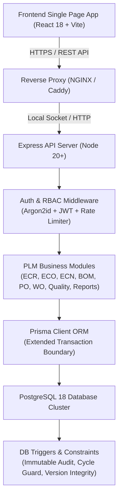

# ECOFlow — System Architecture & Concurrency Control Specification

This document provides the authoritative technical reference for the ECOFlow Product Lifecycle Management (PLM) platform, covering transaction isolation boundaries, advisory locks, database integrity triggers, and role-based access control (RBAC).

---

## 1. System Overview

---

## 2. PostgreSQL Advisory Lock Serialization Keys

To prevent concurrency deadlocks and race conditions across multi-session engineering mutations, ECOFlow utilizes PostgreSQL transaction-scoped advisory locks (`pg_advisory_xact_lock`). These locks automatically release at the end of the surrounding transaction boundary (`COMMIT` or `ROLLBACK`).

| Advisory Lock ID | Domain / Module | Guarded Operations | Code Location |
|---|---|---|---|
| `4200000001001` | **BOM Management** | Adding, updating, or deleting BOM components; multi-level hierarchy mutations; cost rollups. | `backend/src/modules/bom/bom.service.ts` |
| `4200000001002` | **ECO Review & Release** | Submitting revisions for review; approver sign-offs; version generation. | `backend/src/modules/eco/eco.service.ts` |
| `4200000001003` | **ECR Processing** | Promoting change requests to formal change orders; lead engineer reviews. | `backend/src/modules/ecr/ecr.service.ts` |
| `4200000001004` | **ECN Distribution** | Formal issuance and distribution of change notices; department sign-offs. | `backend/src/modules/ecn/ecn.service.ts` |

---

## 3. Database Integrity Invariants & Immutability Triggers

1. **Cycle-Detection Recursion Guard (`trg_bom_components_cycle_guard`):**
   - Implemented in `database/sql/009_multi_level_bom_support.sql`.
   - Executes recursive common table expression (CTE) traversal on every component insert or update.
   - Raises exception `Circular BOM violation: Adding sub-assembly ... creates a recursive dependency cycle with ancestor BOMs` (SQLSTATE `23514`) if a cyclic dependency is formed.

2. **Approvals Immutability (`trg_approvals_immutable`):**
   - Implemented in `database/sql/005_approval_and_version_integrity.sql`.
   - Rejects all `UPDATE` and `DELETE` operations on `public.approvals` using `fn_reject_update_or_delete()`.
   - Guaranteed single-approval per revision via unique constraint index `approvals_eco_id_revision_number_key`.

3. **Product & BOM Versions Immutability (`trg_product_versions_immutable` / `trg_bom_versions_immutable`):**
   - Point-in-time snapshots created upon ECO release are permanently append-only and cannot be altered or removed.

4. **Negative Inventory Prevention (`chk_inventory_qty_positive`):**
   - Table-level CHECK constraint enforcing `quantity_on_hand >= 0 AND quantity_reserved >= 0`.
   - Supported at API layer in `InventoryService.transactStock` and `ManufacturingService.consumeMaterial`.

---

## 4. Role-Based Access Control (RBAC) Matrix

| Module / Operation | ADMINISTRATOR | LEAD_ENGINEER | APPROVER | OPERATOR |
|---|:---:|:---:|:---:|:---:|
| User Governance (`/api/v1/admin/*`) | **Full Access** | 403 Forbidden | 403 Forbidden | 403 Forbidden |
| System Health Telemetry | **Full Access** | 403 Forbidden | 403 Forbidden | 403 Forbidden |
| Global Audit Timeline (`/activity-timeline`) | **Full Access** | **View Access** | 403 Forbidden | 403 Forbidden |
| Proprietary Reports (`/api/v1/reports/*`) | **Full Access** | **Full Access** | **Full Access** | 403 Forbidden |
| CSV Data Export | **Full Access** | **Full Access** | **Full Access** | 403 Forbidden |
| ECR Submit | **Full Access** | **Full Access** | **Full Access** | **Submit Only** |
| ECR Review & Promotion | **Full Access** | **Full Access** | 403 Forbidden | 403 Forbidden |
| BOM Authoring & Component Additions | **Full Access** | **Full Access** | 403 Forbidden | 403 Forbidden |
| ECO Authoring & Revision Drafts | **Full Access** | **Full Access** | 403 Forbidden | 403 Forbidden |
| ECO Formal Review & Approval | **Full Access** | 403 Forbidden | **Approve / Reject** | 403 Forbidden |
| ECN Generation & Release | **Full Access** | **Full Access** | 403 Forbidden | 403 Forbidden |
| Purchase Order Approval | **Full Access** | 403 Forbidden | **Approve** | 403 Forbidden |
| Work Order Completion | **Full Access** | **Full Access** | **Full Access** | **Log Progress** |

