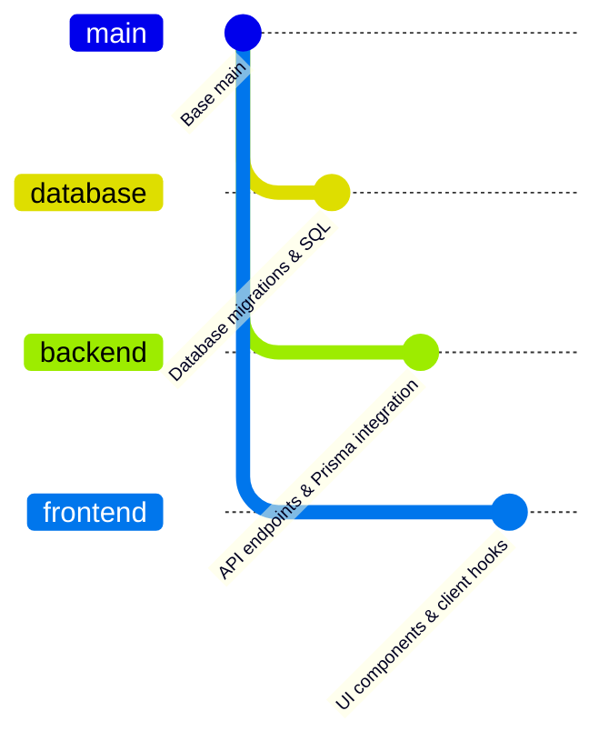

# ECOFlow Git Branching Strategy & Workflow Guide

**Workspace:** `T:\My Projects\ECO-Flow`
**Remote Origin:** `https://github.com/Tejaswaykole/Eco-Flow.git`

---

## 1. Branch Strategy Overview

ECOFlow uses a coordinated monorepo Git branching model where all feature branches retain the **complete repository structure**:



### Intended Branch Roles:
1. **`main`**:
   - The stable, production-ready integration branch.
   - All code deployed to staging or production originates from `main`.
2. **`frontend`**:
   - Branch dedicated to client-side development in `frontend/web` and `frontend/mobile`.
   - Contains the full monorepo so developers can run backend/shared packages locally.
3. **`backend`**:
   - Branch dedicated to server-side development in `backend/` and API integrations.
4. **`database`**:
   - Branch dedicated to database schema evolution, Prisma migrations, and SQL functions in `database/`.

---

## 2. Common Base Commit Requirement

> **CRITICAL RULE:** All three development branches (`frontend`, `backend`, `database`) **must originate from the exact same commit on `main`** after the monorepo restructuring has been committed.
>
> Under no circumstances should branches be created from disparate historical commits, nor should branches be initialized as isolated single-directory repositories.

---

## 3. Safe Step-by-Step Branch Creation Plan

Once the restructuring changes are reviewed and approved:

### Step 1: Commit Restructuring on a Dedicated Branch (Optional) or `main`
```powershell
# Stage all restructured files and updated configuration
git add .

# Create the foundational commit on main
git commit -m "chore(monorepo): restructure project into frontend, backend, and database workspaces"
```

### Step 2: Create the Three Specialized Branches from the Common Base
```powershell
# Ensure you are on the updated main commit
git checkout main

# Create the database branch from current main
git branch database

# Create the backend branch from current main
git branch backend

# Create the frontend branch from current main
git branch frontend
```

### Step 3: Verify That All Branch Starting Hashes Match
```powershell
git rev-parse main
git rev-parse database
git rev-parse backend
git rev-parse frontend
```
*(All 4 outputs must output the identical commit SHA).*

### Step 4: Push to GitHub Remote Only After Explicit Authorization
```powershell
# Push branches to remote origin
git push origin main
git push origin database
git push origin backend
git push origin frontend
```
